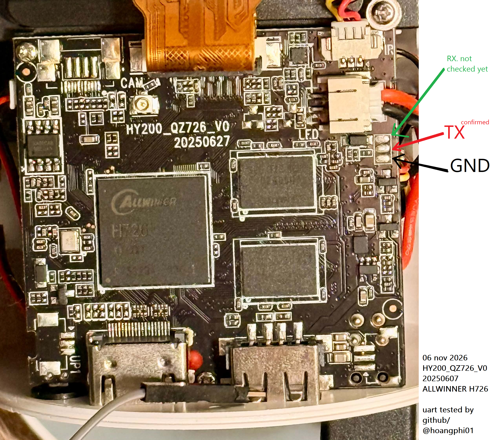

# UART debug console (H726 / HY300 Ultra)

The serial console on the HY300 Ultra (Allwinner **H726 / sun50iw15**, board `HY200_QZ726_V0`).
This is the single most useful bring-up tool: it prints the whole boot, from the mask-ROM `boot0`
through ATF/OP-TEE/U-Boot to the Linux console. Confirmed working **2026-11-06** - a full stock boot
log was captured clean (8963 bytes, 100% printable). Reference log: [h726-stock-uart-boot.txt](h726-stock-uart-boot.txt).

## Pad location



A **3-pad cluster at the top-right of the board**, next to the `LED` silkscreen and the small
white power/LED wire connector (red/black/yellow leads). From **top to bottom: RX, TX, GND**.

- **TX** (middle pad) is the one that prints - this is what you read. It idles at ~3.3 V and, while
  transmitting during boot, a multimeter averages it to **~2.64 V** (that 2.64 V reading is the
  give-away for the active TX).
- **GND** (bottom pad) = 0 V. **RX** (top pad) = ~3.3 V idle; RX is not needed just to read, and has
  not been probed yet.
- **Not** the `UP1` cluster near the USB-C/HDMI connectors (bottom-left) - that was a decoy that tested
  dead. And **not** the pad by the USB port that floods garbage at every baud - that is USB D+/D- data,
  not UART.

## Electrical / settings

| | |
|---|---|
| SoC pins | **UART0: PH0 (TX) / PH1 (RX)** |
| Register base | `0x02600000` (`snps,dw-apb-uart`, mmio32, reg-shift 2) |
| Logic level | **3.3 V** |
| Baud / format | **115200 8N1**, no flow control |

(From the vendor `bootargs`: `earlyprintk=sunxi-uart,0x02600000 ... console=ttyAS0,115200`.)

## Wiring (read-only, safe)

- **Board TX (middle pad) -> adapter RXD**
- **Board GND (bottom pad, or any ground / HDMI shell) -> adapter GND**
- **Do NOT connect** the adapter's TXD or any power pin to the board (TX/5 V can over-drive the 3.3 V
  SoC; we only read). Be careful probing - a slip onto a power rail killed the first adapter.

## Reading it

A **CP2102** (genuine Silicon Labs, 3.3 V) works perfectly on the first try. A CH340G (2 Mbps) is a
fine alternative. Avoid no-name PL2303 clones (one died from a probe short and dropped constantly).

The Windows CP210x/CH340 driver gives a COM port for **PuTTY** (115200 8N1) directly. On this machine
the Windows driver was missing, so the device is read through **usbipd -> WSL** instead:

```
# once, in an ADMIN PowerShell:
usbipd bind --force --busid <busid>
# then (non-admin), with a WSL instance running:
usbipd attach --wsl --busid <busid>
# in WSL (as root, port is root:dialout):
screen /dev/ttyUSB0 115200          # live view
# or a scripted capture during a power-cycle
```

The usbip link drops when the WSL VM idles - hold a `wsl -u root -- sleep` keepalive and re-`attach`
on a drop. Confirm the adapter first with a TXD<->RXD loopback before trusting a 0-byte read.

## What the stock boot log gives us

The reference log maps a healthy boot and pins down several facts (see
[h726-stock-uart-boot.txt](h726-stock-uart-boot.txt)):

- `HELLO! BOOT0 is starting!` - mask-ROM boot0 prints at 115200.
- **DRAM: 1024 MB DDR3, 792 MHz, external ZQ.**
- `Loading boot-pkg` (u-boot / monitor / scp / optee) then
  `Jump to ATF: monitor_base=0x48000000, uboot_base=0x4a000000, optee_base=0x48600000` - the ATF/OP-TEE
  bases match our DTS `/memreserve/` entries.
- BL31: **OP-TEE 32bit + U-Boot 32bit** (v2.5). `U-Boot 2018.07 ... Model: sun50iw15, CPU=1008 MHz`.
- `Android's image name: arm` - the stock kernel is **32-bit ARM**, which validates our build-32-bit
  decision (see [../kernel/bringup-strategy.md](../kernel/bringup-strategy.md)).
- `[SCP]: arisc ready` - the ARISC co-processor comes up before Linux (relevant to the watchdog, whose
  secure `R_WDOG` is ARISC-owned; see [bringup-signals.md](bringup-signals.md)).
- `Booting Linux ... Linux version 5.15.167 ... CPU: ARMv7 Processor [410fd034]` - the stock kernel also
  uses `earlycon` on this same UART, confirming our earlycon path works.

This log is the reference to compare our own kernel against.

## What our own mainline kernel shows (2026-11-06)

The earlycon `boot_hb.img` (our mainline **6.16.7**, 32-bit) was flashed to the active `boot_a` and read
live. **Our kernel runs** - and the earlycon output confirms the UART base from our own kernel, not borrowed
(see [h726-kernel-earlycon-boot.txt](h726-kernel-earlycon-boot.txt)):

- `Linux version 6.16.7 ... CPU: ARMv7 Processor [410fd034]`, `Machine model: Magcubic HY300 Ultra
  Projector (bring-up)` - our kernel + our DTS.
- **`earlycon: uart8250 at MMIO32 0x02600000`** - the base `0x02600000` is confirmed correct by our own kernel.
- Reaches `psci: PSCIv1.1 detected`, `arch_timer ... 24.00MHz`, cmdline parse, RCU/clocksource init.
- Then `Console: colour dummy device` / `legacy console [tty0] enabled` / **`legacy bootconsole [uart8250]
  disabled`** - and the log goes dark.

The silence is **not a crash**: at the earlycon->console handover the kernel disables the earlycon
bootconsole, and its only registered real console is the `tty0` dummy (no serial console claimed), so it
keeps running but stops printing to the UART. Fix: add **`keep_bootcon ignore_loglevel`** to the kernel
cmdline (done in [../kernel/build.sh](../kernel/build.sh)) so the earlycon is never dropped; the next flash
reads straight past the handover. (Harmless warning in the log: `DT /cpu 2 nodes greater than max cores 1`,
from `nr_cpus=1` against the 2-CPU DT.)

## Driving U-Boot (bidirectional)

Add a third wire - **adapter TXD -> board RX (the top pad of the 3-pad cluster)** - and the same CP2102
becomes an interactive U-Boot console. That unlocks a `/data`-safe test loop (load a test kernel into RAM
and `bootm` it, leaving stock `boot_a` untouched - no FEL, no `/data` wipe). The wiring, level safety, the
U-Boot command set (`sunxi_flash read`, `bootm`-only), and the full loop are in
[uboot-console.md](uboot-console.md).
